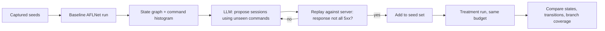

# Stateful Protocol Fuzzing with LLMs

Network protocols are hard targets: the server keeps state, messages must arrive in order, and most of the interesting code runs only after authentication or negotiation. Tools such as AFLNet, StateAFL and SGFuzz infer states from response codes or memory, but they still start from captured traffic and blind mutation.

## What a model contributes

Models have read most RFCs. ChatAFL's insight was to use that knowledge in three places:

1. **Grammar extraction:** ask for the message format of each request type (e.g. RTSP `SETUP`, `PLAY`) and turn the answer into mutation templates that keep the structure valid.
2. **Seed enrichment:** ask for message sequences that reach states missing from the initial captures.
3. **Plateau breaking:** when coverage stalls, give the model the recent message sequence and server responses, and ask for the next message that would move to a new state.

## A practical architecture

```
                ┌────────────┐
 pcap / spec ──►│ LLM: types │──► message templates + state graph (draft)
                └────────────┘
                       │
                       ▼
 ┌─────────────────────────────────────────────┐
 │ stateful fuzzer (AFLNet/LibAFL-based)       │
 │  - select state                              │
 │  - replay prefix to reach it                 │
 │  - mutate next message within template       │
 │  - observe response code + coverage          │
 └─────────────────────────────────────────────┘
                       │ plateau > T minutes
                       ▼
                ┌─────────────┐
                │ LLM: next   │──► new sequences appended to corpus
                │ message?    │
                └─────────────┘
```

## Snapshots matter more than models

Replaying a 12-message prefix for every test case is slow. Snapshot fuzzing (Nyx, or LibAFL with QEMU snapshots) restores process state in microseconds. Combine snapshots with LLM-proposed sequences and you can explore deep states cheaply. Without snapshots, the model's ideas take too long to test.

## Targets that are under-fuzzed

- Industrial protocols (Modbus, DNP3, IEC 104, OPC UA). Specs are public, captures are rare.
- Telecom (Diameter, GTP, SIP), where the state machines are huge.
- Blockchain P2P layers: devp2p/RLPx, libp2p gossipsub, consensus-layer req/resp. Client diversity means differential testing is possible (Chapter 7 of the decentralized-security-compute book covers distributing this).
- Custom binary RPCs inside games and IoT firmware, where the model infers structure from decompiled handlers.

## Differential oracles

Memory-safe implementations rarely crash. Use **differential** oracles instead: send the same sequence to two implementations (for example two Ethereum execution clients) and flag divergent responses or state roots. LLMs help write the *normalisers* that hide irrelevant differences (timestamps, ordering).

## Turning model output into something a fuzzer can use

A model's description of a protocol is prose. A fuzzer needs data structures. Ask for output in a fixed JSON schema and validate it before use. A minimal schema has message types, fields with types and whether they are mutable, and allowed transitions.

```json
{
  "protocol": "FTP",
  "messages": [
    {"name": "USER", "template": "USER <str:username>\r\n", "mutable": ["username"]},
    {"name": "PASS", "template": "PASS <str:password>\r\n", "mutable": ["password"]},
    {"name": "PASV", "template": "PASV\r\n", "mutable": []},
    {"name": "RETR", "template": "RETR <path:file>\r\n", "mutable": ["file"]}
  ],
  "transitions": [["INIT","USER","NEED_PASS"],["NEED_PASS","PASS","AUTHED"],["AUTHED","PASV","DATA_READY"]]
}
```

Validate it in two ways. Syntactically, with a JSON Schema validator. Semantically, by replaying each template against the real server and checking the response code class (2xx/3xx for FTP). Templates that draw 500-series syntax errors on the reference server are wrong, or the server diverges from the RFC, which is worth a note.

## Worked example: enriching an AFLNet campaign

Not executed in this book's CI; the commands, code and expected outputs below are illustrative. Verify locally before relying on them.

AFLNet and ProFuzzBench ship Docker setups for small servers such as LightFTP. The steps below follow the AFLNet README's command-line shape.

**Step 1 – baseline run.** Inside the ProFuzzBench LightFTP container, run AFLNet with the provided seeds:

```bash
afl-fuzz -d -i in-ftp -o out-base -N tcp://127.0.0.1/2200 \
  -x ftp.dict -P FTP -D 10000 -q 3 -s 3 -E -K -R \
  ./fftp fftp.conf 2200
```

`-P FTP` selects the FTP response parser, `-E` enables state-aware mode and `-R` region-level mutation. After a fixed time, record `out-base/ipsm.dot` (the inferred state machine) and the number of states.

**Step 2 – ask for missing sequences.** Give the model the list of FTP commands seen in the seeds and the list from RFC 959 and its extensions (e.g. `REST`, `APPE`, `MLSD`, `SITE`). Ask for 20 short sessions, each a sequence of commands that uses at least one unseen command, written as raw text with CRLF endings.

**Step 3 – convert to AFLNet seeds.** AFLNet seeds are raw request byte streams. Write each session to `in-ftp-llm/seq_NN.raw`, validate by replaying against the server with `nc` and checking that responses are not all `500`:

```bash
printf 'USER ubuntu\r\nPASS ubuntu\r\nMLSD\r\nQUIT\r\n' | nc -q1 127.0.0.1 2200
```

**Step 4 – treatment run.** Run again with `-i in-ftp-plus-llm` (original plus new seeds), same time budget, same flags, multiple trials.

**Step 5 – compare.** Count states and transitions in each `ipsm.dot`, and compare branch coverage with the ProFuzzBench coverage scripts. Report medians over trials, not a single run.



## Common pitfalls

- **Credentials and environment drift.** Model sessions use guessed usernames. Put the real test credentials in the prompt or every sequence dies at login.
- **Non-reset servers.** If the server keeps files or sessions between test cases, crashes will not reproduce. Use AFLNet's cleanup script option or snapshots.
- **Counting response codes as states blindly.** Many servers return the same code from different internal states. Combine with coverage or memory-based state inference.
- **Timeouts set too tight.** Network targets need `-D` and socket timeouts tuned; too tight and deep states look unreachable.
- **Fuzzing production endpoints.** Only fuzz servers you run locally or are explicitly authorised to test.

## Exercises

1. Run AFLNet against a small FTP server for one hour. Then add 20 LLM-generated sequences that use rarely seen commands and compare state coverage.
2. Write a prompt that converts an RFC section into a message template in a JSON schema of your design.
3. Design a differential harness for two DNS resolvers. What must be normalised?

## Further reading

- ChatAFL: <https://github.com/ChatAFLndss/ChatAFL>
- AFLNet: <https://github.com/aflnet/aflnet>
- Nyx / Nyx-Net: Schumilo et al., USENIX Security 2021; EuroSys 2022
- LibAFL: <https://github.com/AFLplusplus/LibAFL>
- Natella & Pham, "ProFuzzBench", ISSTA 2021
