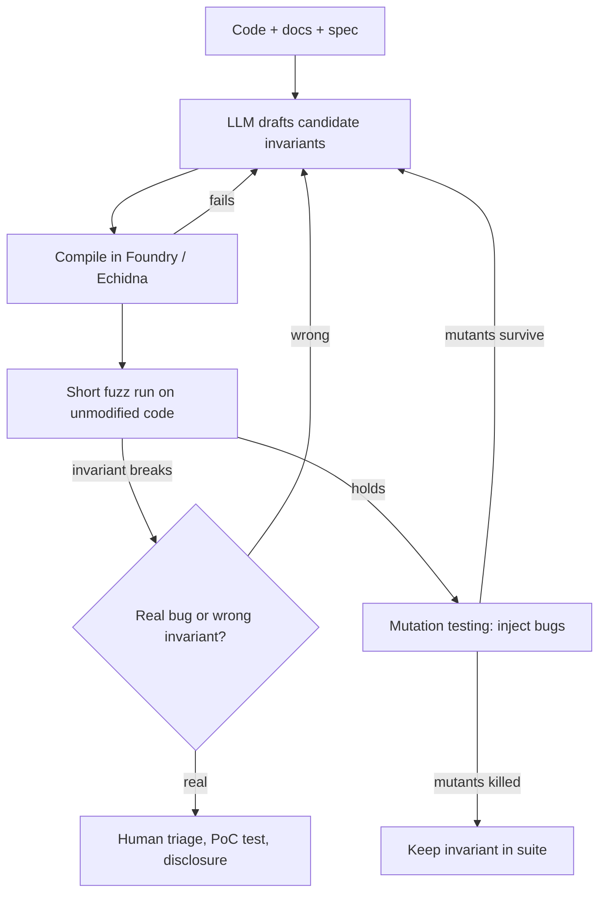

# AI for Smart Contract Fuzzing

Smart contract fuzzing differs from native fuzzing in ways that make AI assistance unusually effective:

- The "input" is a **sequence of transactions** from several actors, with values and timing.
- Crashes are rare and uninteresting. Bugs are **violations of economic invariants** ("total supply equals sum of balances", "a user cannot withdraw more than they deposited").
- The interesting code is small (hundreds to a few thousand lines) and fits in a model's context window.

## The tool landscape

| Tool | Approach |
|---|---|
| Foundry `forge` invariant tests | property/stateful fuzzing in Solidity |
| Echidna (Trail of Bits) | property-based, Haskell |
| Medusa (Trail of Bits) | parallel, Go, geth-based |
| ItyFuzz (FuzzLand) | snapshot-based, on-chain forking, Rust |
| Halmos / hevm / Kontrol | symbolic testing of the same properties |

## Where models help most: writing invariants

Fuzzers are only as good as their properties. Most audit fuzzing campaigns fail because the invariants are shallow. A model reading the code plus documentation can propose candidates in categories:

1. **Accounting:** sums, conservation of value, share/asset ratios.
2. **Access control:** only role X changes Y.
3. **Monotonicity:** indexes only grow, nonces never repeat.
4. **Solvency:** `totalAssets() >= totalLiabilities` after every action.
5. **Round-trip:** `deposit` then `redeem` never returns more than was deposited (modulo yield).

Then **filter** them: an invariant that fails in the first minute on a known-good codebase is usually wrong (or a real bug, so look). An invariant that never fails and covers nothing is useless. Use mutation testing (e.g. Certora's Gambit, or `vertigo-rs`) to check that the invariant suite *kills* injected bugs.

## Handlers and actor modelling

Foundry invariant testing works best with **handler contracts** that bound inputs and model actors. Models write these well when given the external interface:

```solidity
contract VaultHandler is Test {
    Vault vault; MockERC20 asset;
    address[] actors;
    function deposit(uint256 actorSeed, uint256 amount) external {
        address a = actors[actorSeed % actors.length];
        amount = bound(amount, 1, 1e30);
        asset.mint(a, amount);
        vm.startPrank(a);
        asset.approve(address(vault), amount);
        vault.deposit(amount, a);
        vm.stopPrank();
        ghost_deposited[a] += amount;          // ghost variable for invariants
    }
}
```

## On-chain forking and exploit synthesis

ItyFuzz and Foundry can fork mainnet state. A research direction with defensive value: given a known exploited protocol (DeFiHackLabs has hundreds of reproductions), can an AI-guided fuzzer **rediscover** the exploit from the pre-hack state? This is a good benchmark because the ground truth exists.

## The invariant-generation loop



The diagram makes the division of labour explicit. The model drafts. The compiler, the fuzzer and the mutation tool decide what survives. A human decides whether a break is a real bug.

## Worked example: a model-written invariant suite for an ERC-4626 vault

Not executed in this book's CI; the commands, code and expected outputs below are illustrative. Verify locally before relying on them.

Use a small vault built on OpenZeppelin's `ERC4626` or Solmate's implementation, in a Foundry project.

**Step 1 – prompt.** Provide the vault source, the ERC-4626 standard's text for `deposit`, `mint`, `withdraw`, `redeem` and the preview functions, and ask for invariants grouped by the five categories above, each with a one-sentence rationale.

**Step 2 – handler and ghost variables.** Use the handler pattern shown earlier, with `deposit`, `withdraw`, `redeem` and a `donate` action (a direct token transfer to the vault, which models donation and inflation attacks). Track `ghost_deposited`, `ghost_withdrawn` and `ghost_donated` as public totals so the invariant contract can read them.

**Step 3 – invariant contract.**

```solidity
contract VaultInvariants is StdInvariant, Test {
    Vault vault; MockERC20 asset; VaultHandler handler;

    function setUp() public {
        asset = new MockERC20("A", "A", 18);
        vault = new Vault(asset);
        handler = new VaultHandler(vault, asset);
        targetContract(address(handler));
    }

    // solvency: shares are always backed
    function invariant_solvency() public view {
        assertGe(asset.balanceOf(address(vault)),
                 vault.convertToAssets(vault.totalSupply()));
    }

    // conservation: nobody withdrew more than was put in (incl. donations)
    function invariant_conservation() public view {
        assertLe(handler.ghost_withdrawn(),
                 handler.ghost_deposited() + handler.ghost_donated());
    }
}
```

**Step 4 – run.** Configure depth and runs in `foundry.toml`:

```toml
[invariant]
runs = 256
depth = 100
fail_on_revert = false
```

```bash
forge test --match-contract VaultInvariants -vv
```

A pass prints lines such as `[PASS] invariant_solvency() (runs: 256, calls: 25600, reverts: ...)`. Look at the revert count: if most calls revert, the handler bounds are wrong and the fuzzer is exploring nothing.

**Step 5 – mutation check.** Run Gambit on the vault to produce mutants (for example, flipped rounding direction in `convertToShares`), then run the suite against each mutant. Record which mutants survive. A survivor that changes rounding means you lack a round-trip invariant such as "`redeem(deposit(x))` never exceeds `x`". Add it and repeat.

**Step 6 – cross-check with a second engine.** Run the same properties in Echidna or Medusa (both support Foundry-style projects via `crytic-compile`). Different engines explore differently; a property that holds under both is more trustworthy.

## Common pitfalls

- **Invariants that restate the code.** "`totalSupply` equals what `totalSupply()` returns" is always true and useless. Invariants should come from the spec or economics.
- **Handlers that always revert.** Unbounded inputs make most calls fail. Check revert ratios in the output.
- **Missing actors.** A single-actor handler cannot find bugs that need an attacker and a victim. Model at least three addresses and direct token transfers.
- **Fork tests with no pinned block.** Mainnet-fork fuzzing must pin `--fork-block-number` or results are irreproducible.
- **Treating a broken invariant as an exploit.** It is a lead. Write a minimal Foundry test that shows impact, then follow disclosure rules. Never test on live deployments you do not own.

## Exercises

1. Pick a simple ERC-4626 vault. Have a model generate 15 invariants, implement them in Foundry, and run mutation testing to measure kill rate.
2. Reproduce one DeFiHackLabs incident and check whether Medusa or ItyFuzz finds it from the pre-hack fork with model-written properties.
3. Compare model-written handlers with Echidna's default random-call strategy on coverage.

## Further reading

- Foundry invariant testing: <https://book.getfoundry.sh/forge/invariant-testing>
- Echidna: <https://github.com/crytic/echidna>; Medusa: <https://github.com/crytic/medusa>
- ItyFuzz: Shou et al., ISSTA 2023, <https://github.com/fuzzland/ityfuzz>
- DeFiHackLabs: <https://github.com/SunWeb3Sec/DeFiHackLabs>
- Trail of Bits, "Building Secure Contracts": <https://secure-contracts.com>
- See also the book **llm-smart-contract-vuln-research** in this wiki.
